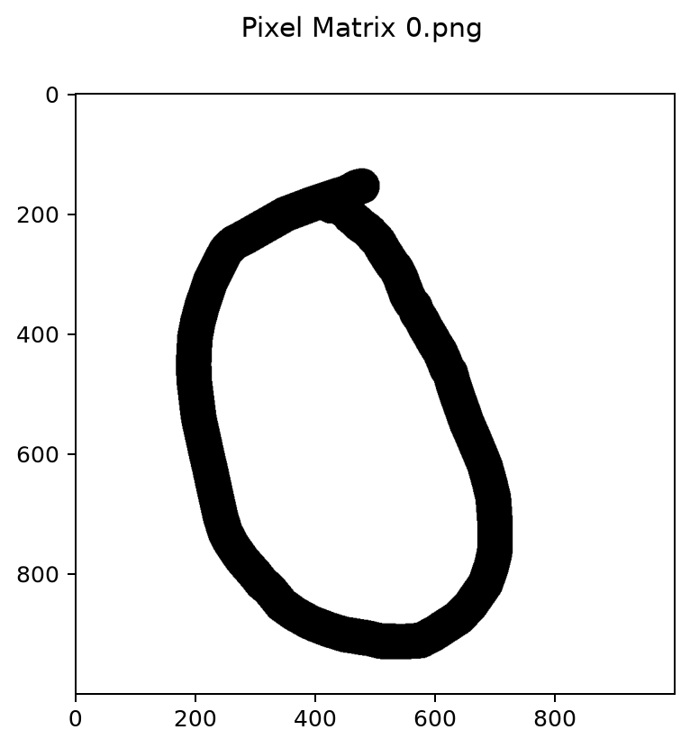
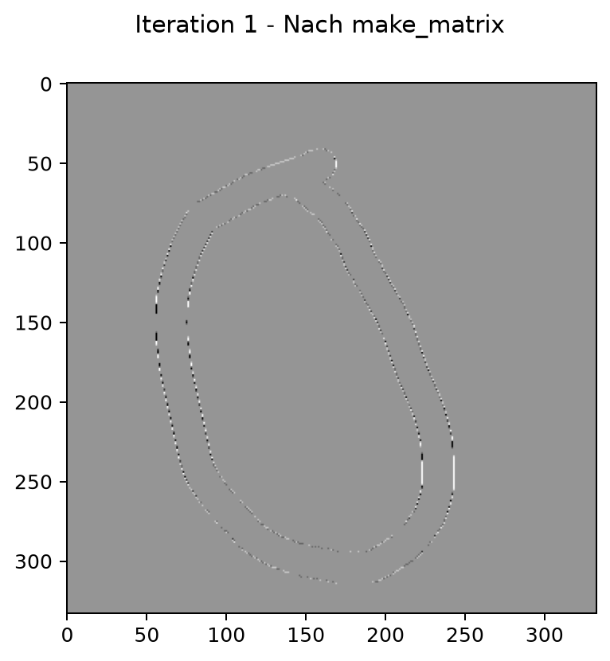
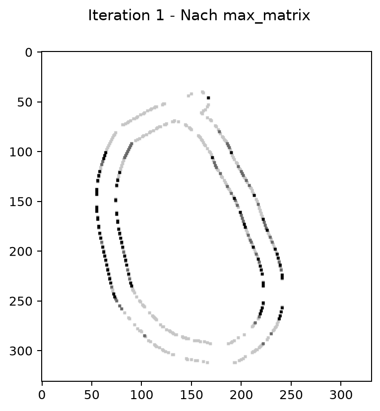
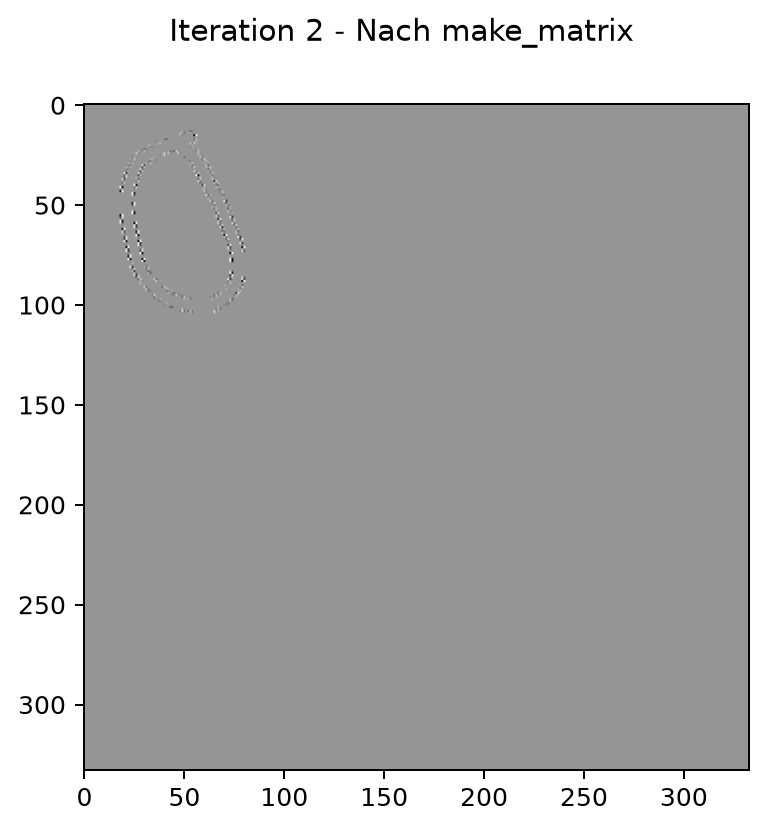
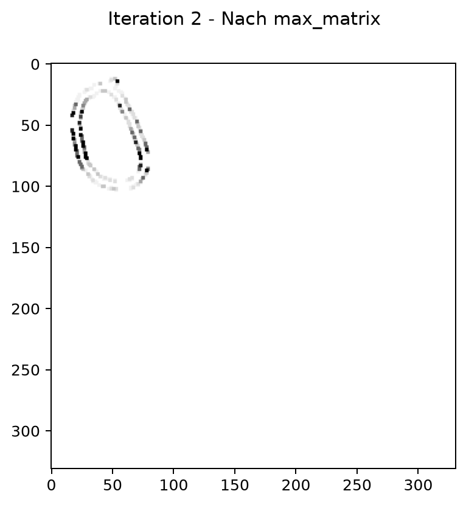

# Bildverarbeitung – Galerie

Die fünf Ansichten zeigen die vollständige Verarbeitung des mitgelieferten Bildes `0.png`. Sie sind direkt gespeicherte Matplotlib-Ausgaben des Programms.

## Binärmatrix

Das Eingabebild wird in Werte von 0 und 255 überführt.

## Erste Faltung

Der 3×3-Kernel betont Strukturen der gezeichneten Ziffer.

## Erster Maximumfilter

Überlappende Fenster wählen jeweils den größten Wert.

## Zweite Faltung

Die Verarbeitung setzt mit der bereits gefilterten Matrix fort.

## Zweiter Maximumfilter

Die letzte Ansicht schließt die zweite Filterfolge ab.

[Projekt und Technik](PROJEKT.md) · [Zur Übersicht](../README.md). Alle Angaben und Downloads ohne Gewähr.
